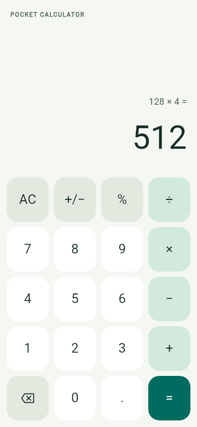

# Minimal mobile calculator

A Flutter calculator for Android and iOS in `qianyizhang/mobile-test`. The Flutter project lives at the repository root.

## Features and arithmetic

- Digits, decimal input, addition, subtraction, multiplication and division
- Change sign, percent, clear, backspace and repeated equals
- Immediate execution: `2 + 3 × 4 =` calculates `(2 + 3) × 4`, not algebraic precedence
- Percent: `50 %` is `0.5`; `200 + 10 % =` is `220`; `200 × 10 % =` is `20`
- Up to 12 input digits; results displayed to 12 significant digits; division by zero/overflow shows a recoverable error
- Responsive portrait/landscape keypad, labeled screen-reader controls and at least 48-point touch targets
- Calculator logic is separated from the UI and covered by automated tests

This is a small everyday calculator. It uses floating-point arithmetic; it is not intended for exact financial accounting or scientific computation.

## Toolchain

Use **Flutter 3.47.7 stable**, which bundles **Dart 3.13.5**. Do not separately install Dart or run `flutter upgrade` for this project. Commit and retain `pubspec.lock`.

The generated Android toolchain uses Gradle 9.3.1 and Android Gradle Plugin 9.1.0. Use JDK 17, Android SDK Platform 36, Build Tools 36.0.0 and NDK 28.2.13676358. Recheck the checked-in Android files and the pinned Flutter SDK if these versions are changed. Android Studio is optional for a headless APK build.

The Android native scaffold and iOS native scaffold are included. Their presence is not evidence of a successful native build.

## Quick checks

Run from the repository root after Flutter is available:

```bash
flutter --version
flutter pub get
bash scripts/check.sh
```

The check script runs:

```bash
dart format --output=none --set-exit-if-changed lib test
flutter analyze
flutter test
```

Unit and widget tests can run on Linux without an Android emulator, Android SDK or Xcode. They do not replace a device smoke test.

## Android

After installing the Android SDK and reviewing its licenses:

```bash
flutter doctor -v
flutter build apk --debug
```

The expected output is `build/app/outputs/flutter-apk/app-debug.apk`. This is a debug build using a development key, not a store-ready release. Do not add production signing keys to the repository.

To run interactively on an already available Android device or emulator:

```bash
flutter devices
flutter run -d <android-device-id>
```

A cloud Linux machine can run tests and build APKs without an emulator. Emulator availability depends on the host, virtualization support and access to `/dev/kvm`; a successful APK build does not establish that an emulator can run.

## iOS: a separate macOS step

Linux cannot run Xcode, build an iOS app or run the iOS Simulator. The following is a checklist for a future, separately authorized macOS environment; it is not part of cloud Linux setup and does not authorize operating your Mac.

Install the matching Flutter SDK for that Mac's architecture and a compatible Xcode from Apple's official distribution. If Xcode has not been configured, review Apple's terms before accepting them, then perform the relevant setup steps:

```bash
sudo xcode-select -s /Applications/Xcode.app/Contents/Developer
sudo xcodebuild -license
sudo xcodebuild -runFirstLaunch
xcodebuild -downloadPlatform iOS
```

After setup, from the repository root:

```bash
flutter doctor -v
flutter pub get
bash scripts/check.sh
flutter build ios --simulator --debug
xcrun simctl list devices available
```

Open `Simulator` on Xcode 26 or earlier (`open -a Simulator`), or `DeviceHub` on Xcode 27 (`open -a DeviceHub`). Select/boot an available iPhone simulator, then:

```bash
flutter devices
flutter run -d <ios-simulator-device-id>
```

Install CocoaPods only if the project's native dependencies/tooling require it, following its official instructions. Simulator testing does not require production signing. Running on an actual iPhone requires separate device trust/developer setup and development signing; App Store distribution requires its own signing, account and release process. No signing or deployment is configured here.

## Saved Linux cloud environment

See [CLOUD_SETUP_PROMPT.md](CLOUD_SETUP_PROMPT.md) for a pasteable setup request, version pins, license checkpoints and acceptance criteria. Pasting the request does not itself create a saved environment: select this repository in the environment configuration UI, save the configuration and its setup script, and select it when starting later coding tasks.

No paid CI workflow, cloud service purchase, credential change or production deployment is included.

## Validation status

Validated on Linux with Flutter 3.47.7 / Dart 3.13.5:

- `flutter pub get`: passed; lockfile included
- Formatting: passed
- `flutter analyze`: passed, no issues
- `flutter test`: passed, 26 tests (20 engine + 6 widget tests)
- Widget layouts checked at 320×568, 390×844, 844×390, plus enlarged text
- Android/iOS scaffold: generated with the official `flutter create --platforms=android,ios --project-name=mobile_calculator --org=com.qianyizhang` command
- Android debug APK: not built; `flutter doctor` reports no Android SDK in the authoring environment
- Android emulator/device smoke test: not run; no SDK/device or `/dev/kvm` available
- iOS simulator build/run: not run; requires macOS with Xcode

The authoring environment also lacks a Linux desktop toolchain/Chrome, and its Flutter doctor proxy check crashes. These are environment findings, not passing native-build checks. The saved-environment prompt includes a clean toolchain/network validation.



Preview rendered in Flutter widget tests at 390×844; this is not an Android/iOS device screenshot.

## Official references

- [Flutter installation](https://docs.flutter.dev/install/manual)
- [Flutter Android setup](https://docs.flutter.dev/platform-integration/android/setup)
- [AGP 9.1 compatibility](https://developer.android.com/build/releases/agp-9-1-0-release-notes)
- [Android SDK manager](https://developer.android.com/tools/sdkmanager)
- [Android emulator acceleration](https://developer.android.com/studio/run/emulator-acceleration)
- [Flutter iOS setup](https://docs.flutter.dev/platform-integration/ios/setup)
